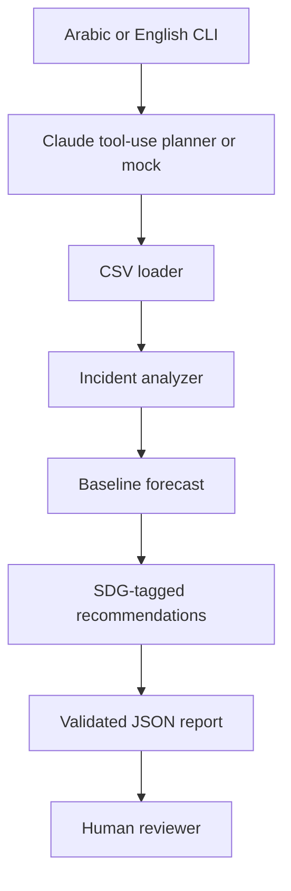

# Saudi Road Safety AI Agent — Vision 2030 & UN SDGs

  

**Author:** Dr. Muhammad Zulkifl Hasan, University of Central Punjab (UCP), Lahore. ORCID: [0000-0002-2733-5527](https://orcid.org/0000-0002-2733-5527).

## Problem

Analyze road-safety incident records to support human review of incident concentrations and safer street design. **Sample records are synthetic** and do not establish actual accident hotspots. This prototype is not suitable for enforcement, fault attribution, or deployment without validation.

## Vision 2030 and SDGs

| Vision 2030 | UN SDG target / official indicator | Project proxy |
|---|---|---|
| Vibrant Society; Quality of Life program (contextual alignment) | **3.6 / 3.6.1** death rate due to road traffic injuries | Incident and injury counts; not a death rate |
| Safer mobility (contextual alignment) | **11.2 / 11.2.1** convenient access to public transport | Suggested pedestrian audits; not official indicator |

See [problem selection](docs/PROBLEM_SELECTION.md) and [SDG alignment](docs/SDG_ALIGNMENT.md). Sources: https://www.vision2030.gov.sa/ ; https://sdgs.un.org/goals/goal3 ; https://sdgs.un.org/goals/goal11 ; https://unstats.un.org/sdgs/metadata/ .

## Architecture



Four allowlisted domain tools: `load_data`, `analyze_incidents`, `forecast_incidents`, `recommend_actions`. Live Claude uses the Anthropic Python SDK; mock mode is deterministic and does not require credentials.

## Quickstart

Python 3.11+:

```bash
python -m pip install -e '.[dev]'
vision2030-agent --mock --language en
vision2030-agent --mock --language ar
pytest -q
ruff check .
```

For live mode, copy `.env.example` to `.env`, set `ANTHROPIC_API_KEY` locally (never commit it), then run:

```bash
vision2030-agent --language en
```

## Actual mock-mode output

The following was captured from `PYTHONPATH=src python -m vision2030_sdg_agent.cli --mock --language en`:

```json
{
  "language": "en",
  "mode": "mock",
  "record_count": 5,
  "total_injuries": 5,
  "total_fatalities": 1,
  "highest_incident_district": "Riyadh North",
  "peak_hour": 18,
  "forecast_incidents": 5,
  "recommendations": [
    {
      "action": "Request a human road-safety audit in Riyadh North",
      "sdg_target": "3.6",
      "confidence_note": "Low confidence: small synthetic sample; field validation required"
    },
    {
      "action": "Review pedestrian crossing safety around 18:00",
      "sdg_target": "11.2",
      "confidence_note": "Low confidence: small synthetic sample; field validation required"
    }
  ],
  "limitations": "Synthetic sample; not for enforcement or fault attribution"
}
```

## Limitations and future work

The sample is synthetic, tiny, and not exposure-adjusted. The baseline is simply the observed count, not a validated predictive model. No population denominator is provided for SDG indicator 3.6.1; no public-transport access survey exists for 11.2.1. Live Claude integration is not verified. Future work: ingest licensed Saudi open data, validate data quality and Arabic terminology, add exposure denominators, temporal cross-validation, uncertainty estimates, privacy review under Saudi PDPL, and external field evaluation.

## Citation

```bibtex
@software{hasan_vision2030_road_safety_2026,
  author = {Hasan, Muhammad Zulkifl},
  title = {Saudi Road Safety AI Agent — Vision 2030 and SDGs},
  year = {2026},
  version = {0.1.0}
}
```

MIT licensed. See [CITATION.cff](CITATION.cff).

## Web dashboard and Vercel

The repository root [index.html](index.html) contains a zero-dependency, bilingual, responsive web dashboard. Vercel can host it as a static site by importing this repository with **Framework Preset: Other**, **Root Directory: .**, and no build command or output directory override. The dashboard parses up to 10,000 de-identified CSV records (2 MB maximum), displays incident counts by district and hour, provides human-reviewed SDG 3.6 / 11.2 suggestions, and exports a JSON report. It runs entirely in the browser and never uploads CSV contents to the hosting server. Use the **Analyze example** button to view the synthetic sample.

**Important:** The static web dashboard uses deterministic JavaScript analysis, not the Anthropic Claude SDK. Claude agent tool use remains available via the Python CLI and requires ANTHROPIC_API_KEY for live use. Do not call the static dashboard a live Claude deployment or a validated risk predictor. For later server-side Claude integration, build authenticated endpoints with quotas and configure the key as a Vercel server environment variable, not in client JavaScript.
