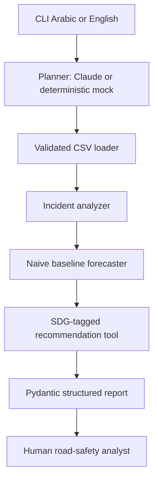

# Architecture

The live planner uses Anthropic tool-use with a strict allowlist and a 12-round cap. Computations and recommendations are derived from local tools, not model-generated numeric claims. The mock route runs deterministically without network or credentials. No tool makes operational or enforcement changes.
